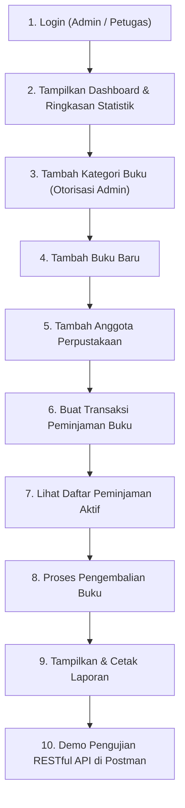

# 📋 Skenario & Panduan Demo Ujian Akhir Semester (UAS)

## Sistem Informasi Manajemen Perpustakaan Digital Kampus

Dokumen ini disusun sebagai panduan langkah demi langkah (_step-by-step walk-through_) pelaksanaan presentasi dan demo langsung aplikasi sesuai dengan **Skenario UAS (Pertemuan 11 - Master Outline Bagian I)**.

---

## 🛠️ Persiapan Sebelum Memulai Demo

Sebelum memanggil dosen penguji atau memulai perekaman layar/presentasi:

1. **Pastikan Database MySQL Aktif** (misal via XAMPP / Laragon).
2. **Database Telah Dimigrasi & Diseed**:
    ```bash
    cd app-perpustakaan
    php artisan migrate:fresh --seed
    ```
3. **Wajib Menjalankan DUA Server PHP Artisan**:
    - **Terminal 1 (Web Interface):**
        ```bash
        cd app-perpustakaan
        php artisan serve --port=8000
        ```
    - **Terminal 2 (Internal API Server):**
        ```bash
        cd app-perpustakaan
        php artisan serve --port=8011
        ```
        _(Penjelasan: Server 8011 bertugas melayani request REST API statistik internal dari Controller Dashboard dan Laporan tanpa menimbulkan deadlock)._
4. **Siapkan Aplikasi Postman** dan impor file koleksi:  
   📁 `postman/Perpustakaan_API.postman_collection.json` (atau di folder `app-perpustakaan/Perpustakaan_API.postman_collection.json`).

---

## 🔑 Kredensial Pengguna untuk Demo

| Role        | Email Login           | Password   | Hak Akses Utama                                                                                                 |
| :---------- | :-------------------- | :--------- | :-------------------------------------------------------------------------------------------------------------- |
| **Admin**   | `admin@pens.ac.id`    | `password` | Akses penuh (Dashboard, CRUD Kategori, CRUD Buku, CRUD Anggota, Transaksi & Laporan).                           |
| **Petugas** | `petugas1@pens.ac.id` | `password` | Akses operasional (Dashboard, Buku, Anggota, Peminjaman, Pengembalian, Laporan). **Tidak bisa akses Kategori**. |

---

## 🎬 Urutan 10 Langkah Demo Skenario UAS



---

### Langkah 1: Login ke Sistem

- **Tujuan**: Mendemonstrasikan sistem autentikasi, validasi form, middleware guest/auth, dan otorisasi role.
- **URL**: `http://127.0.0.1:8000/login`
- **Aksi Demo**:
    1. Buka browser pada URL `http://127.0.0.1:8000/`. Sistem otomatis mengarahkan ke form login jika belum login.
    2. _(Opsional - Uji Validasi)_: Coba klik tombol **Login** tanpa mengisi input atau masukkan email salah (`salah@pens.ac.id` / `12345`). Tunjukkan pesan error validasi muncul secara informatif.
    3. Masukkan kredensial Administrator:
        - **Email**: `admin@pens.ac.id`
        - **Password**: `password`
    4. Klik tombol **Login**.
- **Hasil yang Diharapkan**:
    - Muncul notifikasi flash message sukses: _"Login berhasil, selamat datang Admin Perpustakaan."_
    - Pengguna langsung diarahkan (_redirect_) ke halaman utama Dashboard.

---

### Langkah 2: Tampilkan Dashboard

- **Tujuan**: Menunjukkan arsitektur konsumsi internal REST API (`GET /api/stats` dari port 8011) oleh controller Laravel untuk menampilkan data analitik secara _real-time_.
- **URL**: `http://127.0.0.1:8000/` atau `http://127.0.0.1:8000/dashboard`
- **Aksi Demo**:
    1. Jelaskan kartu analitik (_stat-cards_) yang tampil pada dashboard:
        - **Total Koleksi Buku**: Jumlah buku yang tercatat di database.
        - **Total Anggota Terdaftar**: Jumlah mahasiswa/anggota aktif.
        - **Peminjaman Sedang Berlangsung**: Jumlah transaksi pinjaman yang berstatus `dipinjam`.
    2. Jelaskan kepada dosen bahwa data kartu ini diambil melalui `Http::get('http://127.0.0.1:8011/api/stats')` menggunakan Laravel HTTP Client secara decoupled.
- **Hasil yang Diharapkan**:
    - Angka statistik tampil akurat sesuai hasil seeding awal.
    - Terdapat panel menu navigasi cepat menuju modul-modul lainnya.

---

### Langkah 3: Tambah Kategori Buku (Hak Akses Administrator)

- **Tujuan**: Membuktikan proteksi _Role-Based Access Control_ (RBAC) menggunakan middleware `admin` (`CheckAdminRole`).
- **URL**: `http://127.0.0.1:8000/categories` &rarr; Klik **+ Tambah Kategori**
- **Aksi Demo**:
    1. Klik menu navigasi **Kategori** di navbar atas.
    2. Klik tombol **+ Tambah Kategori**.
    3. Masukkan data kategori baru:
        - **Nama Kategori**: `Kecerdasan Buatan & Data Science`
        - **Deskripsi**: `Koleksi buku mengenai Machine Learning, Deep Learning, dan Analisis Big Data.`
    4. Klik tombol **Simpan**.
- **Catatan Pembuktian Otorisasi**:
    > [!TIP]
    > Tunjukkan kepada dosen bahwa jika user login sebagai Petugas (`petugas1@pens.ac.id`), menu _Kategori_ disembunyikan dari navbar dan jika diakses langsung lewat URL akan mengembalikan HTTP **403 Forbidden** (_"Halaman ini hanya bisa diakses oleh admin"_).
- **Hasil yang Diharapkan**:
    - Kategori baru berhasil masuk dan muncul di tabel daftar kategori dengan flash message konfirmasi.

---

### Langkah 4: Tambah Buku Baru

- **Tujuan**: Menguji validasi `StoreBookRequest`, relasi database One-to-Many antara Kategori dan Buku, serta input data buku.
- **URL**: `http://127.0.0.1:8000/books` &rarr; Klik **+ Tambah Buku**
- **Aksi Demo**:
    1. Klik menu **Buku** pada navbar.
    2. Klik tombol **+ Tambah Buku**.
    3. Masukkan data buku berikut:
        - **Kategori**: Pilih `Kecerdasan Buatan & Data Science` (kategori yang baru dibuat di Langkah 3).
        - **Judul Buku**: `Hands-On Machine Learning with Scikit-Learn, Keras, and TensorFlow`
        - **Penulis**: `Aurélien Géron`
        - **Penerbit**: `O'Reilly Media`
        - **Tahun Terbit**: `2023`
        - **ISBN**: `978-1098125974`
        - **Stok**: `8`
    4. Klik tombol **Simpan Buku**.
- **Hasil yang Diharapkan**:
    - Buku baru tersimpan di database dan langsung tercantum di tabel daftar buku.
    - Kembali ke Dashboard untuk memperlihatkan bahwa angka **Total Koleksi Buku** otomatis bertambah 1.

---

### Langkah 5: Tambah Anggota Perpustakaan

- **Tujuan**: Menguji operasi pendaftaran anggota baru, validasi format email, keunikan NIM (_unique_ rule), dan penanganan status anggota.
- **URL**: `http://127.0.0.1:8000/members` &rarr; Klik **+ Tambah Anggota**
- **Aksi Demo**:
    1. Klik menu **Anggota** pada navbar.
    2. Klik tombol **+ Tambah Anggota**.
    3. Masukkan informasi data anggota baru:
        - **Nama Lengkap**: `Fajar Kurniawan`
        - **NIM**: `3125500099` _(Pastikan unik)_
        - **Email**: `fajar.kurniawan@it.pens.ac.id`
        - **Nomor Telepon**: `085711223344`
        - **Alamat**: `Jl. Raya ITS No. 10, Sukolilo, Surabaya`
        - **Status**: Pilih `Aktif`
    4. Klik tombol **Simpan Anggota**.
- **Hasil yang Diharapkan**:
    - Data anggota baru berhasil tersimpan dan tampil di list anggota.
    - Cek Dashboard: Angka **Total Anggota Terdaftar** otomatis ter-update bertambah 1.

---

### Langkah 6: Buat Transaksi Peminjaman Buku

- **Tujuan**: Memperagakan transaksi bisnis inti: relasi Many-to-Many / _Pivot Table_ (`loans` dan `loan_items`), relasi ke `members` dan `users` (petugas yang login).
- **URL**: `http://127.0.0.1:8000/loans/create`
- **Aksi Demo**:
    1. Klik menu **Peminjaman** &rarr; klik tombol **+ Tambah Peminjaman**.
    2. Pilih data peminjaman:
        - **Anggota**: Pilih `Fajar Kurniawan (3125500099)`.
        - **Tanggal Pinjam**: Tanggal hari ini (misal `2026-11-07`).
        - **Batas Tanggal Kembali**: 7 hari kemudian (misal `2026-11-14`).
        - **Pilihan Buku**: Centang minimal 2 judul buku (misal: _Clean Code_ dan buku baru _Hands-On Machine Learning_).
    3. Klik tombol **Simpan Transaksi**.
- **Hasil yang Diharapkan**:
    - Transaksi berhasil tercatat.
    - Tercipta 1 record di tabel `loans` dan 2 record di tabel pivot `loan_items`.
    - Otomatis mencatat ID petugas yang sedang login (`auth()->id()`).

---

### Langkah 7: Lihat Daftar Peminjaman Aktif

- **Tujuan**: Memperlihatkan filtering dan pemantauan daftar peminjaman yang sedang berjalan (_status dipinjam_).
- **URL**: `http://127.0.0.1:8000/loans`
- **Aksi Demo**:
    1. Di halaman **Daftar Peminjaman**, tunjukkan record transaksi baru yang berstatus **Dipinjam** dengan badge kuning/oranye.
    2. Klik link **Detail** pada transaksi tersebut:
        - Tampilkan informasi lengkap peminjam (Nama, NIM).
        - Tampilkan nama petugas yang melayani.
        - Tampilkan daftar detail buku yang dipinjam beserta kategorinya.
        - Tampilkan batas waktu pengembalian.
- **Hasil yang Diharapkan**:
    - Semua relasi Eloquent (`with(['member', 'user', 'loanItems.book'])`) termuat dengan rapi dan efisien tanpa masalah N+1 query.

---

### Langkah 8: Proses Pengembalian Buku

- **Tujuan**: Memproses pengembalian buku (`PUT /loans/{id}/kembalikan`), memperbarui status peminjaman dari `dipinjam` menjadi `dikembalikan`, serta mencatat tanggal penyelesaian pengembalian.
- **Aksi Demo**:
    1. Pada tabel transaksi peminjaman (atau di dalam halaman detail peminjaman yang berstatus _Dipinjam_):
    2. Klik tombol **Kembalikan** (atau **✓ Proses Pengembalian Buku**).
    3. Konfirmasi alert dialog browser jika muncul.
- **Hasil yang Diharapkan**:
    - Muncul notifikasi flash: _"Buku berhasil dikembalikan pada [tanggal hari ini]."_
    - Status transaksi berubah menjadi **Dikembalikan** dengan label warna hijau.
    - Tanggal dikembalikan terisi otomatis dengan tanggal saat ini.
    - Di Dashboard: Angka **Peminjaman Sedang Berlangsung** otomatis berkurang 1.

---

### Langkah 9: Tampilkan & Cetak Laporan

- **Tujuan**: Menampilkan rekapitulasi data seluruh transaksi perpustakaan untuk kebutuhan audit dan pelaporan pimpinan, serta fitur print.
- **URL**: `http://127.0.0.1:8000/loans/report`
- **Aksi Demo**:
    1. Klik menu navigasi **Laporan** di navbar (atau tombol _Laporan Peminjaman_ di dashboard).
    2. Tunjukkan kartu rekapitulasi laporan di bagian atas:
        - Total Transaksi Keseluruhan.
        - Peminjaman Aktif.
        - Peminjaman Telah Dikembalikan.
        - Peminjaman Terlambat.
    3. Tunjukkan tabel detail riwayat peminjaman yang lengkap dengan nama anggota, NIM, buku yang dipinjam, petugas, tanggal pinjam, batas kembali, tanggal kembali riil, dan status.
    4. Klik tombol **🖨️ Cetak Laporan** untuk mendemonstrasikan kesiapan dokumen siap cetak/PDF via browser dialog.
- **Hasil yang Diharapkan**:
    - Halaman laporan terformat rapi dan dialog print browser terbuka dengan tampilan bersih.

---

### Langkah 10: Demo Pengujian REST API di Postman

- **Tujuan**: Membuktikan bahwa endpoint RESTful API backend berjalan independen, merespons dengan standar status code HTTP yang benar (200 OK, 201 Created, 422 Unprocessable Content), dan menghasilkan payload JSON terstruktur.
- **Aplikasi**: Postman Desktop / Web Agent
- **Target Server**: `http://127.0.0.1:8011/api` _(atau `http://127.0.0.1:8000/api`)_

#### Daftar Request yang Didemokan di Postman:

|   No   | Endpoint                          | Method | Keterangan & Parameter                                | Expected HTTP Status |
| :----: | :-------------------------------- | :----: | :---------------------------------------------------- | :------------------: |
| **1**  | `{{base_url}}/stats`              | `GET`  | Mengambil statistik analitik buku, anggota, pinjaman. |       `200 OK`       |
| **2**  | `{{base_url}}/books`              | `GET`  | Menampilkan koleksi buku (pagination + metadata).     |       `200 OK`       |
| **3**  | `{{base_url}}/books?judul=Clean`  | `GET`  | Pencarian buku dengan Query Parameter judul.          |       `200 OK`       |
| **4**  | `{{base_url}}/books/1`            | `GET`  | Detail data buku by ID.                               |       `200 OK`       |
| **5**  | `{{base_url}}/books`              | `POST` | Menambah data buku baru via JSON Body.                |    `201 Created`     |
| **6**  | `{{base_url}}/books/1`            | `PUT`  | Memperbarui data buku via JSON Body.                  |       `200 OK`       |
| **7**  | `{{base_url}}/members`            | `GET`  | Mengambil daftar seluruh anggota perpustakaan.        |       `200 OK`       |
| **8**  | `{{base_url}}/members/1`          | `GET`  | Mengambil data spesifik anggota by ID.                |       `200 OK`       |
| **9**  | `{{base_url}}/loans`              | `GET`  | Mengambil seluruh transaksi peminjaman buku.          |       `200 OK`       |
| **10** | `{{base_url}}/loans`              | `POST` | Membuat transaksi peminjaman baru via API.            |    `201 Created`     |
| **11** | `{{base_url}}/loans/1/kembalikan` | `PUT`  | Mengembalikan buku via endpoint API.                  |       `200 OK`       |

#### Contoh Payload JSON untuk Demo Postman:

**1. POST `{{base_url}}/books` (Tambah Buku):**

```json
{
    "judul": "Modern Software Engineering & Clean Architecture",
    "penulis": "Dave Farley",
    "penerbit": "Addison-Wesley Professional",
    "tahun_terbit": 2022,
    "isbn": "978-0137314911",
    "stok": 10,
    "category_id": 1
}
```

**2. POST `{{base_url}}/loans` (Peminjaman Baru):**

```json
{
    "member_id": 1,
    "user_id": 1,
    "tanggal_pinjam": "2026-11-07",
    "tanggal_kembali": "2026-11-14",
    "book_ids": [1, 2]
}
```

- **Hasil yang Diharapkan**:
    - Response JSON memiliki struktur baku (menggunakan API Resource `BookResource`, `MemberResource`, `LoanResource`).
    - Response header berisi `Content-Type: application/json`.

---

## 💡 Tips & Jawaban Antisipasi Pertanyaan Penguji

1. **Kenapa harus menjalankan dua server (`8000` dan `8011`)?**

    > _"PHP Development Server bawaan (`php artisan serve`) bekerja secara synchronous dan single-threaded per proses worker. Ketika Dashboard pada port 8000 memanggil HTTP client ke `/api/stats`, jika diarahkan ke port yang sama (8000), server akan mengalami deadlock/freeze karena antrian request pertama menunggu selesainya request kedua yang tidak pernah bisa dieksekusi. Menjalankan server kedua pada port 8011 menjamin pemisahan service API yang siap menerima request internal secara instan."_

2. **Bagaimana arsitektur otorisasi antar Role dibedakan?**

    > _"Kami menerapkan Role-Based Access Control (RBAC) pada field `role` di tabel `users`. Rute umum seperti buku, anggota, peminjaman dilindungi middleware `auth`, sedangkan modul manajemen Kategori dibungkus middleware kustom `CheckAdminRole` (`admin`). Jika user ber-role `petugas` mencoba mengakses rute kategori, sistem memblokir dengan kode status HTTP 403 Forbidden."_

3. **Bagaimana relasi tabel peminjaman dibentuk?**
    > _"Satu transaksi `loans` dimiliki oleh 1 `members` dan dicatat oleh 1 `users` (petugas). Hubungan antara `loans` dan `books` bersifat Many-to-Many melalui tabel pivot `loan_items`, sehingga 1 transaksi peminjaman dapat memuat beberapa buku sekaligus."_

---

_Selamat melaksanakan demo UAS! Semoga sukses dan mendapatkan nilai terbaik!_ 🎉
